# Pitch 项目体系：原型需求与业务思维导图

这份文档把可点击原型收成一棵思维导图：页面在哪、谁能用、业务怎么转。内容出自原型代码、[需求文档](./需求文档.md)（v1.0，2026-10-21）和[方案](./方案.md)。怎么融进小程序见[小程序融合思维导图](./小程序融合思维导图.md)。

- 先看第 0 节，整棵树在一页里。后面各节是同一棵树的展开，不另起概念。
- 编号沿用原文：G1–G12 是全局规则，M01–M17 是功能模块。
- 截图文件名见需求文档附录 B（`docs/screenshots/`）。图片目前不在仓库里，文中链接是对照用的。
- 图用 Mermaid 的流程图、时序图和关系图画。Cursor 自带的 Markdown 预览不支持 mindmap，所以层级关系画成从左往右的流程图。

## 0. 一页总览

```text
Pitch 原型
├─ 要解决的四件事
│  ├─ 用户来得少：创建后没有回来的理由
│  ├─ 创建门槛高：像在投递 BP
│  ├─ 展示弱：项目页只有静态信息
│  └─ 合作流程断：查看联系方式、发起连接、心愿墙三套入口互不相通
├─ 做成什么
│  ├─ 创始人公开主页
│  ├─ 统一意向
│  ├─ 站内对话
│  └─ 背书与路演节律
├─ 核心循环
│  └─ 快速创建 → 公开页 → 被发现 → 关注/背书/建议/意向 → 对话 → 申请撮合 → 工作台与周报 → 发动态 → 再被发现
├─ 谁在用
│  ├─ 创始人：融资、找渠道、招人、被看见。回来看工作台、意向、周报、路演
│  ├─ 投资人：发现和跟踪。回来看观察清单、偏好推荐、答疑、榜单
│  ├─ 人才：找合伙或工作。回来看在招岗位、正在寻找、活动
│  ├─ 产业合作方：找可服务的项目。回来看能提供、合作需求、答疑、榜单
│  ├─ Pitch 运营：撮合、审核、策展。只在运营看板工作，不进人物列表
│  ├─ 游客：公开内容都能看；关注、意向、背书、投票、预约都要登录
│  └─ 会员：意向不限次。档位和价格本期不定
├─ 页面（桌面顶栏 / 顶栏动作 / 头像菜单）
│  ├─ 顶栏：首页 / 、发现 /discover 、信息流 /feed 、活动 /events 、月度路演 /demo-day 、榜单 /lists
│  ├─ 顶栏动作：创建项目（弹层）、收件箱 /inbox（未读对话 + 待回应意向）、通知 /notifications
│  ├─ 头像菜单：我的主页 /u/[handle] 、各项目工作台 /dashboard/[slug] 、我的意向 /me/intents
│  │            观察清单 /watchlist（仅投资人）、答疑 /office-hours 、任务中心 /rewards
│  │            周报 /digest 、运营看板 /ops（仅运营）、产品建议、退出
│  ├─ 无顶栏：首次引导 /welcome 、周报样式预览 /digest/preview
│  ├─ 移动端底栏 5 项：首页、发现、创建、收件箱、我的（进个人主页）
│  └─ 右上角演示身份：林川、周敏、陈一、王岚、阿珂、张三、游客。正式产品没有
├─ P0 主线，没有它循环跑不通
│  ├─ M01 引导与首页：四步引导；首页按身份给出待处理的事
│  ├─ M02 发现：项目 / 人 / 需求 / 榜单。项目只显示公开且已上墙
│  ├─ M03 项目公开页：链接即可看。意向卡、动态、背书、建议
│  ├─ M04 统一意向：一个弹层替代查看联系方式、发起连接、心愿墙留言
│  ├─ M05 收件箱：只由接受意向产生。联系方式在对话里分享，撮合在这里申请
│  ├─ M06 创建与完善：名称、一句话、赛道三项即发布。完成度 9 项，80% 才能上墙和报名路演
│  ├─ M07 工作台：概览、意向、成员、动态、建议、曝光、分享物料
│  └─ M17 撮合与上墙审核：随 M05 一起上，否则申请没人接
├─ P1 让人每周回来
│  ├─ M08 个人主页：开放状态、正在寻找、关联项目、背书
│  ├─ M09 观察清单：只对投资人，完全私密，项目方只看到人数
│  ├─ M10 活动：线上直播、线下聚会。在场后才能打招呼
│  ├─ M11 信息流：项目动态、Pitch 报道、行业快讯
│  └─ M12 通知与周报：站内、服务号、每周一 09:00 周报
├─ P2 节律与激励
│  ├─ M13 月度路演：报名、入围约 6 个、每人 3 票、路演夜、战报
│  ├─ M14 榜单：运营、投资人、合作方可建。创始人和人才不能建
│  ├─ M15 贡献换次数：5 类任务，每类每月首次 +1 次意向
│  ├─ M16 答疑预约：投资人和合作方开放时段，预约不耗次数
│  └─ M17 其余：高意向项目、路演审核
├─ 必须记住的规则
│  ├─ G1 先发后审：创建即有公开页，上发现页、进榜单、进路演才审核
│  ├─ G2 可见范围：公开到发现，或仅持链接可见
│  ├─ G4 意向次数：非会员每月 5 次，贡献最多再 +5，每月 1 日重置。撤回不退
│  ├─ G5 不泄露拒绝：7 天内都是「等待回应」，之后都是「暂未回应」
│  ├─ G6 联系方式永不公开，只在对话里由本人分享
│  └─ 对话不能凭空发起，只能由接受意向产生
└─ 本期不做
   ├─ 身份认证（用投资人背书做软认证）
   ├─ 负面评价
   ├─ 站内凭空私信
   └─ 付费买徽章或曝光
```

## 1. 总图

```mermaid
flowchart LR
  n0["Pitch 项目体系原型"]
  n1["为什么做"]
  n0 --> n1
  n2["用户来得少：创建后没有回来的理由"]
  n1 --> n2
  n3["创建门槛高：像在投递 BP"]
  n1 --> n3
  n4["展示弱：只有静态信息"]
  n1 --> n4
  n5["合作流程断：三套入口互不相通"]
  n1 --> n5
  n6["做成什么"]
  n0 --> n6
  n7["创始人公开主页"]
  n6 --> n7
  n8["统一意向"]
  n6 --> n8
  n9["站内对话"]
  n6 --> n9
  n10["背书与路演节律"]
  n6 --> n10
  n11["给谁用"]
  n0 --> n11
  n12["创始人"]
  n11 --> n12
  n13["投资人"]
  n11 --> n13
  n14["人才"]
  n11 --> n14
  n15["产业合作方"]
  n11 --> n15
  n16["Pitch 运营"]
  n11 --> n16
  n17["游客"]
  n11 --> n17
  n18["会员：意向不限次"]
  n11 --> n18
  n19["P0 主线循环"]
  n0 --> n19
  n20["M01 首次引导与首页"]
  n19 --> n20
  n21["M02 发现页"]
  n19 --> n21
  n22["M03 项目公开页"]
  n19 --> n22
  n23["M04 统一意向"]
  n19 --> n23
  n24["M05 收件箱与对话"]
  n19 --> n24
  n25["M06 快速创建与完善"]
  n19 --> n25
  n26["M07 项目工作台"]
  n19 --> n26
  n27["P1 回访理由"]
  n0 --> n27
  n28["M08 个人主页"]
  n27 --> n28
  n29["M09 投资人观察清单"]
  n27 --> n29
  n30["M10 活动"]
  n27 --> n30
  n31["M11 信息流"]
  n27 --> n31
  n32["M12 通知与周报"]
  n27 --> n32
  n33["P2 节律与激励"]
  n0 --> n33
  n34["M13 月度路演"]
  n33 --> n34
  n35["M14 榜单"]
  n33 --> n35
  n36["M15 贡献奖励与徽章"]
  n33 --> n36
  n37["M16 答疑预约"]
  n33 --> n37
  n38["M17 运营撮合看板：撮合部分随 P0"]
  n33 --> n38
  n39["全局规则"]
  n0 --> n39
  n40["G1 先发后审"]
  n39 --> n40
  n41["G2 可见范围"]
  n39 --> n41
  n42["G3 完成度"]
  n39 --> n42
  n43["G4 意向次数"]
  n39 --> n43
  n44["G5 不泄露拒绝"]
  n39 --> n44
  n45["G6 联系方式不公开"]
  n39 --> n45
  n46["G7 隐私"]
  n39 --> n46
  n47["G8 署名与正向"]
  n39 --> n47
  n48["G9 来源归因"]
  n39 --> n48
  n49["G10 状态规范"]
  n39 --> n49
  n50["G11 深链"]
  n39 --> n50
  n51["G12 响应式"]
  n39 --> n51
  n52["怎么衡量"]
  n0 --> n52
  n53["北极星：每周进入对话的意向数"]
  n52 --> n53
  n54["本期不做"]
  n0 --> n54
  n55["身份认证"]
  n54 --> n55
  n56["负面评价"]
  n54 --> n56
  n57["站内凭空私信"]
  n54 --> n57
  n58["付费买徽章或曝光"]
  n54 --> n58
```

## 2. 为什么做、做成什么

### 2.1 核心循环

需求文档的原话：每个功能都要回答一个问题，它让循环里的哪一步更顺，或者给了哪个身份一个回来的理由。

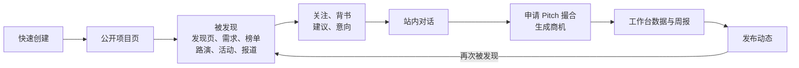

### 2.2 目标、手段和衡量

指标目标值要在上线前和业务一起定，需求文档只定义了口径。

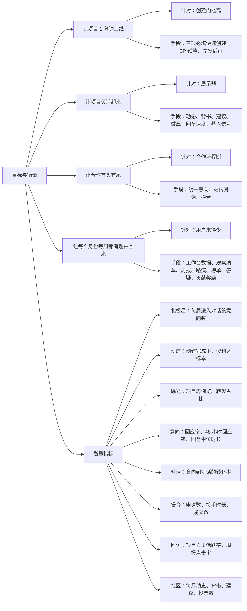

## 3. 身份与权限

### 3.1 六种身份

身份由用户在引导里自选，不做认证，之后可以在主页修改。

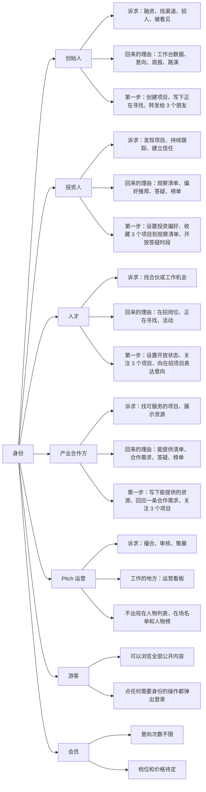

### 3.2 平台权限

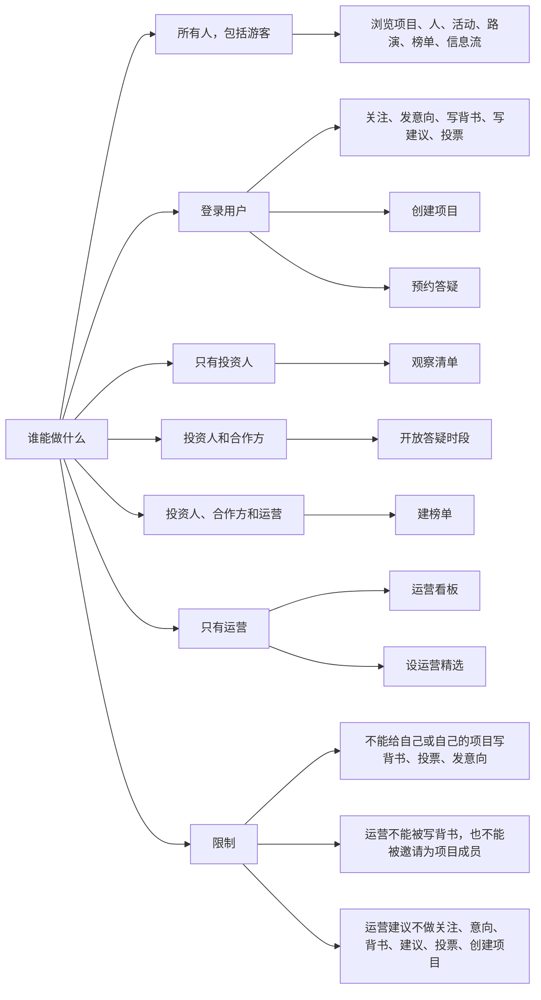

### 3.3 项目成员权限

四级权限逐级叠加，每一级都包含下一级的全部能力。

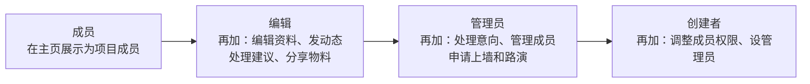

## 4. 全局规则 G1–G12

这些规则跨多个模块，各模块不再重复。

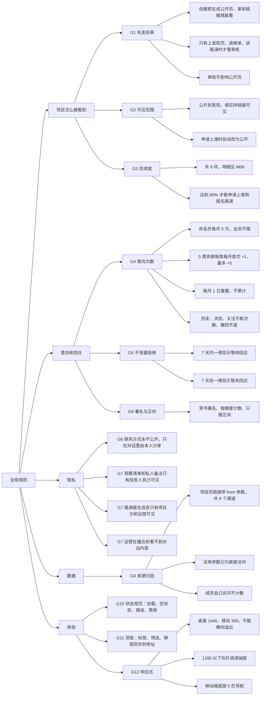

## 5. 功能模块

优先级分三批：P0 是主线循环，没有它核心循环跑不通；P1 给每个身份每周回来的理由；P2 让社区有周期、有动力。M17 的撮合部分要随 M05 一起上线，否则申请撮合没人接；M03 的上墙审核和 M13 的路演入围也依赖 M17 的审核部分。

### 5.1 P0 主线循环

#### M01 首次引导与首页

路由 `/welcome`、`/`。截图：[创始人首页](./screenshots/01-home-founder.jpg)、[投资人首页](./screenshots/01-home-investor.jpg)、[运营首页](./screenshots/01-home-ops.jpg)、[首次引导](./screenshots/01-welcome-newbie.jpg)。

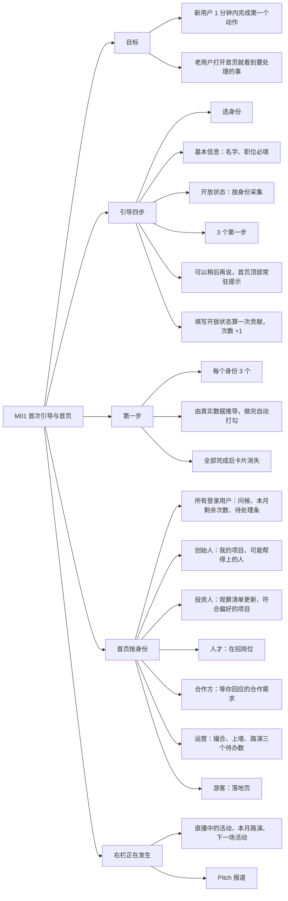

#### M02 发现页

路由 `/discover`。截图：[项目](./screenshots/02-discover-projects.jpg)、[需求](./screenshots/02-discover-needs.jpg)。

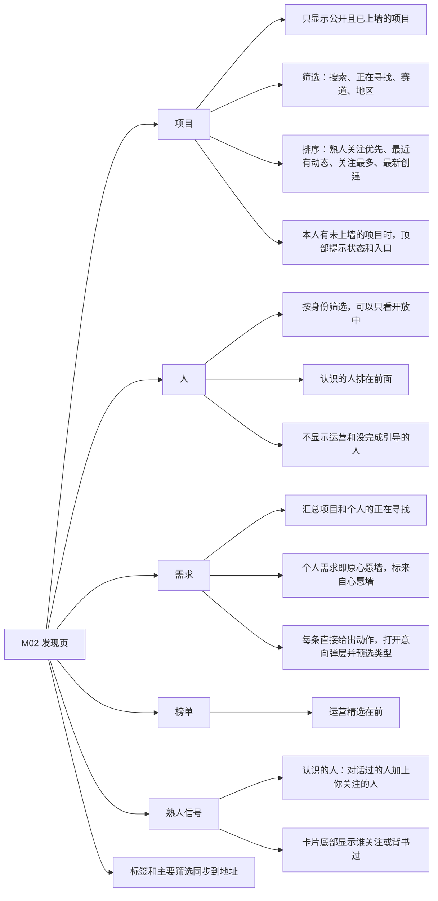

#### M03 项目公开页

路由 `/p/[slug]`。截图：[访客视角](./screenshots/03-project-page-visitor.jpg)、[本人视角](./screenshots/03-project-page-owner.jpg)、[移动端](./screenshots/m-project-page.jpg)。

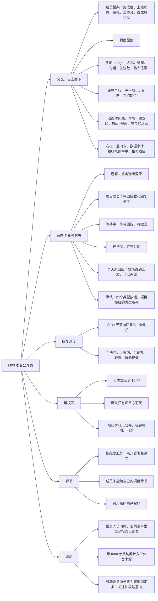

#### M04 统一意向

入口是全局弹层，列表在 `/me/intents`。截图：[我的意向](./screenshots/04-my-intents-talent.jpg)。

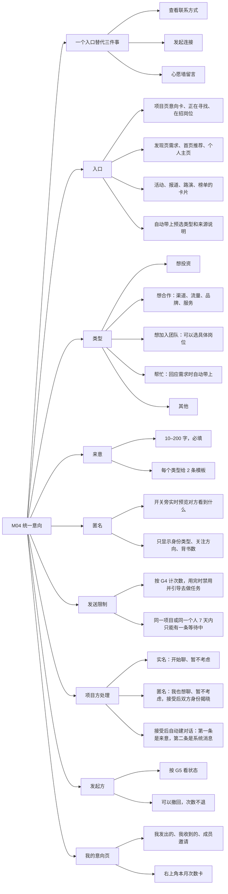

意向的生命周期：

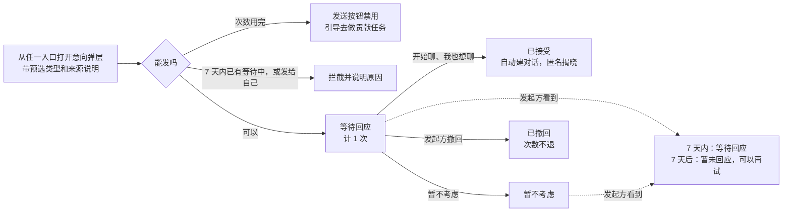

#### M05 收件箱与对话

路由 `/inbox`。截图：[对话](./screenshots/05-inbox-conversation.jpg)、[移动端](./screenshots/m-inbox-conversation.jpg)。

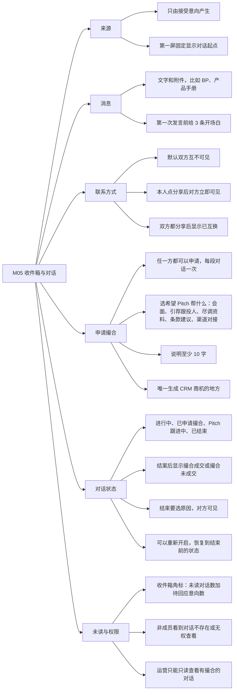

对话与撮合的流转（撮合阶段由运营在 M17 里更新）：

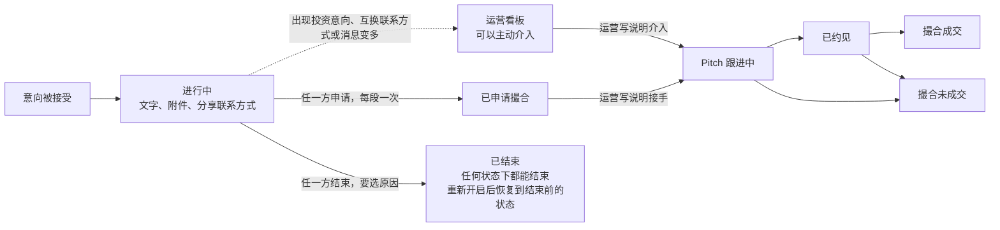

#### M06 快速创建与完善

入口是全局弹层，编辑页 `/p/[slug]/edit`。截图：[完善页](./screenshots/06-project-edit.jpg)。

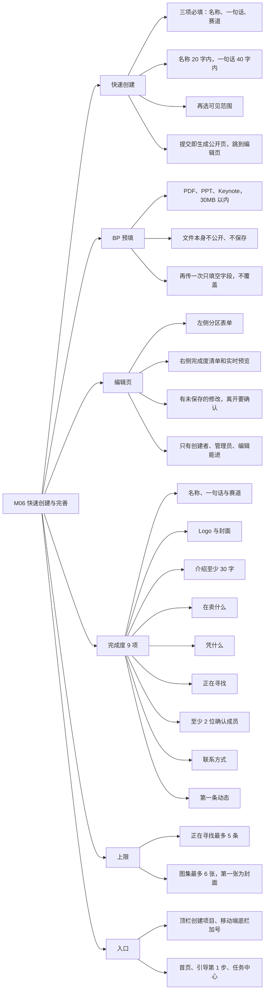

#### M07 项目工作台

路由 `/dashboard/[slug]`，7 个标签同步到 `?tab=`。截图：[概览](./screenshots/07-dashboard-overview.jpg)、[意向](./screenshots/07-dashboard-intents.jpg)、[移动端](./screenshots/m-dashboard.jpg)。

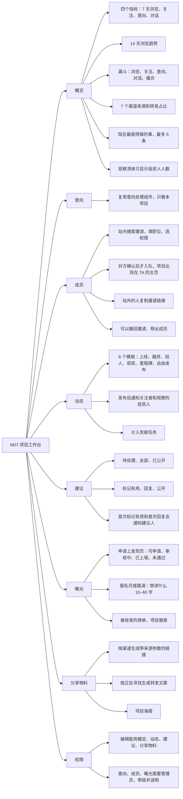

项目从创建到上发现页（G1、G2、G3 加上 M17 的上墙审核）：

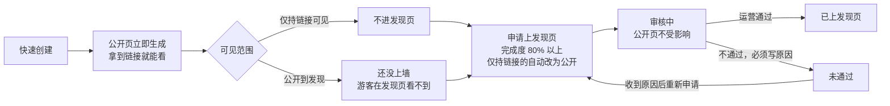

### 5.2 P1 回访理由

#### M08 个人主页

路由 `/u/[handle]`。截图：[创始人](./screenshots/08-profile-founder.jpg)、[投资人](./screenshots/08-profile-investor.jpg)、[移动端](./screenshots/m-profile.jpg)。

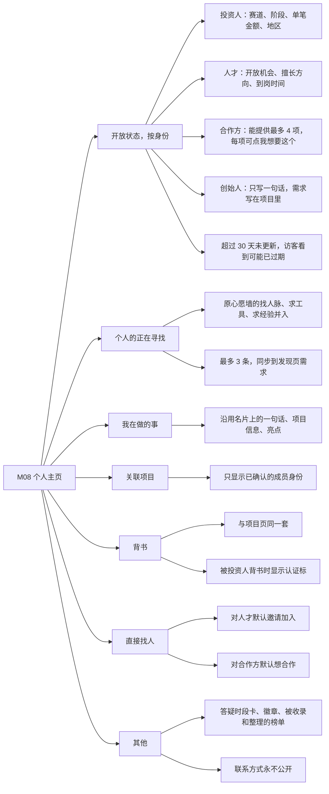

#### M09 投资人观察清单

路由 `/watchlist`。截图：[观察清单](./screenshots/09-watchlist.jpg)。

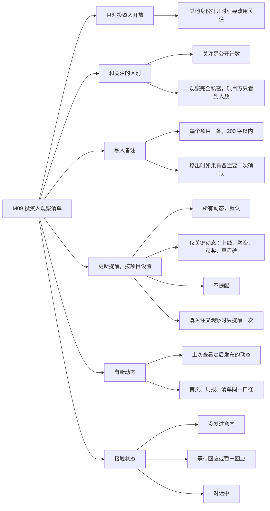

#### M10 活动

路由 `/events`。截图：[活动列表](./screenshots/10-events.jpg)、[直播中](./screenshots/10-event-live.jpg)。

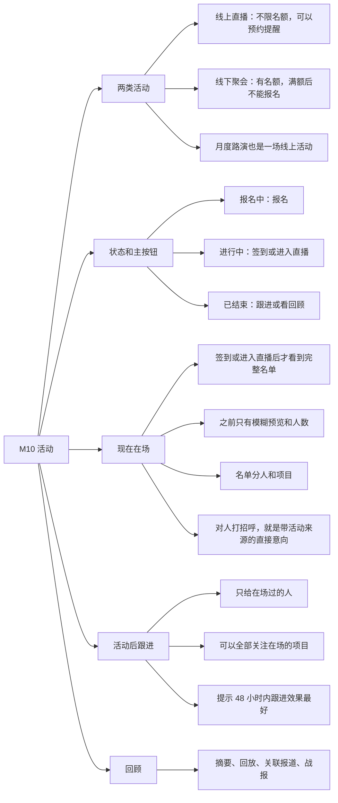

#### M11 信息流

路由 `/feed`。截图：[信息流](./screenshots/11-feed.jpg)。

```mermaid
flowchart LR
  n0["M11 信息流"]
  n1["三种内容，按时间倒序混排"]
  n0 --> n1
  n2["项目动态：只来自公开项目"]
  n1 --> n2
  n3["Pitch 报道"]
  n1 --> n3
  n4["行业快讯"]
  n1 --> n4
  n5["标签"]
  n0 --> n5
  n6["推荐"]
  n5 --> n6
  n7["关注：要登录，包括关注和观察的项目"]
  n5 --> n7
  n8["Pitch 报道"]
  n5 --> n8
  n9["行业快讯：可以按标签筛选"]
  n5 --> n9
  n10["相关提示"]
  n0 --> n10
  n11["和你的项目相关"]
  n10 --> n11
  n12["和你关注的项目相关"]
  n10 --> n12
  n13["鼓励"]
  n0 --> n13
  n14["对动态的轻量反馈，不发通知"]
  n13 --> n14
  n15["不能给自己的项目鼓励"]
  n13 --> n15
  n16["转化"]
  n0 --> n16
  n17["卡片上可以关注、表达意向"]
  n16 --> n17
  n18["招人动态默认选想加入"]
  n16 --> n18
  n19["报道在右侧抽屉阅读，文中的项目可以直接行动"]
  n16 --> n19
```

#### M12 通知与周报

路由 `/notifications`、`/digest`。截图：[通知中心](./screenshots/12-notifications.jpg)、[创始人版周报](./screenshots/12-digest-founder.jpg)、[投资人版周报](./screenshots/12-digest-investor.jpg)。

```mermaid
flowchart LR
  n0["M12 通知与周报"]
  n1["三个出口"]
  n0 --> n1
  n2["站内通知中心：完整记录"]
  n1 --> n2
  n3["服务号即时提醒：只推勾选的类型"]
  n1 --> n3
  n4["周报：每周一 09:00，服务号和邮件"]
  n1 --> n4
  n5["推送规则"]
  n0 --> n5
  n6["通知产生时按当时的设置决定是否推送，并记下来"]
  n5 --> n6
  n7["之后改设置不影响已有通知"]
  n5 --> n7
  n8["周报"]
  n0 --> n8
  n9["频率：每周、有待办时才发、不接收"]
  n8 --> n9
  n10["创始人版、投资人版、精选版，按身份自动选"]
  n8 --> n10
  n11["每一条都能点进对应页面"]
  n8 --> n11
  n12["邮件"]
  n0 --> n12
  n13["要填邮箱"]
  n12 --> n13
  n14["可以单独关闭、一键退订"]
  n12 --> n14
  n15["支持发一份测试"]
  n0 --> n15
```

通知类型（需求文档附录 A），“意向与对话”这一组默认即时推送：

```mermaid
flowchart LR
  n0["通知类型"]
  n1["意向与对话，默认即时推送"]
  n0 --> n1
  n2["意向：收到意向、运营提醒有积压"]
  n1 --> n2
  n3["对话：被接受、新消息、对方分享联系方式、申请撮合、运营接手或更新进展"]
  n1 --> n3
  n4["成员邀请：被邀请、对方确认"]
  n1 --> n4
  n5["答疑预约：有人预约、确认、婉拒、取消"]
  n1 --> n5
  n6["项目"]
  n0 --> n6
  n7["建议：收到建议、被标记有用或被回复"]
  n6 --> n7
  n8["项目动态：关注或观察的项目发了动态"]
  n6 --> n8
  n9["月度路演：入围结果、投票开放、新的报名"]
  n6 --> n9
  n10["与我有关"]
  n0 --> n10
  n11["背书：有人为你或你的项目写背书"]
  n10 --> n11
  n12["奖励：贡献任务完成、获得徽章"]
  n10 --> n12
  n13["榜单：被收录、关注的榜单有新内容"]
  n10 --> n13
  n14["系统"]
  n0 --> n14
  n15["上墙审核结果"]
  n14 --> n15
  n16["测试周报"]
  n14 --> n16
  n17["运营收到新的上墙申请和撮合申请"]
  n14 --> n17
```

### 5.3 P2 节律与激励

#### M13 月度路演

路由 `/demo-day`。截图：[本期](./screenshots/13-demo-day.jpg)、[往期战报](./screenshots/13-demo-day-past.jpg)、[移动端](./screenshots/m-demo-day.jpg)。

```mermaid
flowchart LR
  n0["M13 月度路演"]
  n1["每月一期"]
  n0 --> n1
  n2["一场线上活动，有主题"]
  n1 --> n2
  n3["报名"]
  n0 --> n3
  n4["完成度 80% 以上且公开，不要求已上墙"]
  n3 --> n4
  n5["在工作台写想讲什么"]
  n3 --> n5
  n6["每期只能报一次，截止后不再接受"]
  n3 --> n6
  n7["报名信息只有项目方和运营可见"]
  n3 --> n7
  n8["入围"]
  n0 --> n8
  n9["运营随报随审，每期约 6 个"]
  n8 --> n9
  n10["入围获得路演入围徽章"]
  n8 --> n10
  n11["未入围也会收到通知"]
  n8 --> n11
  n12["投票"]
  n0 --> n12
  n13["与报名并行"]
  n12 --> n13
  n14["每人每期 3 票，同一项目 1 票"]
  n12 --> n14
  n15["路演夜结束前可以撤回改投"]
  n12 --> n15
  n16["不能投自己的项目"]
  n12 --> n16
  n17["随机排序期"]
  n0 --> n17
  n18["开放后前几天，每人看到的顺序不同"]
  n17 --> n18
  n19["同一个人当天顺序不变"]
  n17 --> n19
  n20["不公布票数，之后按票数排序并公开"]
  n17 --> n20
  n21["路演夜"]
  n0 --> n21
  n22["每个项目 6 分钟展示加 4 分钟问答"]
  n21 --> n22
  n23["前三名获得月度路演前三徽章"]
  n21 --> n23
  n24["战报"]
  n0 --> n24
  n25["观看人数、意向数、撮合数、总票数"]
  n24 --> n25
  n26["领奖台、完整排名、回顾，可以分享"]
  n24 --> n26
```

一期路演的节奏：

```mermaid
flowchart LR
    sign["项目报名<br/>完成度 80% 以上且公开"] --> rv{"运营审核"}
    rv -->|入围，每期约 6 个| inn["已入围<br/>路演入围徽章"]
    rv -->|未入围| out["收到通知<br/>下月可以再报"]
    inn --> rnd["随机排序期<br/>不公布票数"]
    rnd --> rank["按票数排序并公开"]
    rank --> night["路演夜<br/>6 分钟展示加 4 分钟问答"]
    night --> top3["前三名<br/>月度路演前三徽章"]
    night --> report["战报"]
    vote["用户投票<br/>每期 3 票，可以改投"] -.-> rnd
    vote -.-> rank
```

#### M14 榜单

路由 `/lists`。截图：[榜单列表](./screenshots/14-lists.jpg)、[榜单详情](./screenshots/14-list-detail.jpg)。

```mermaid
flowchart LR
  n0["M14 榜单"]
  n1["谁能建"]
  n0 --> n1
  n2["运营、投资人、合作方"]
  n1 --> n2
  n3["创始人和人才不能建，避免自荐"]
  n1 --> n3
  n4["谁能管"]
  n0 --> n4
  n5["整理者本人或运营"]
  n4 --> n5
  n6["只有运营能设运营精选"]
  n4 --> n6
  n7["两类榜单"]
  n0 --> n7
  n8["项目榜：只收公开且已上墙的项目"]
  n7 --> n8
  n9["人物榜：只收已选身份的人，不含运营"]
  n7 --> n9
  n10["上限"]
  n0 --> n10
  n11["每条必须写收录理由，1–40 字"]
  n10 --> n11
  n12["每个榜单最多 20 条"]
  n10 --> n12
  n13["名称 30 字内，说明 80 字内"]
  n10 --> n13
  n14["通知"]
  n0 --> n14
  n15["项目被收录通知负责人和管理员，人被收录通知本人"]
  n14 --> n15
  n16["关注榜单的人收到新增"]
  n14 --> n16
  n17["移除不通知"]
  n14 --> n17
  n18["运营精选"]
  n0 --> n18
  n19["榜单页置顶、发现页排最前、进入周报"]
  n18 --> n19
  n20["声明"]
  n0 --> n20
  n21["榜单是整理者的个人判断，不代表 Pitch 背书"]
  n20 --> n21
```

#### M15 贡献奖励与徽章

路由 `/rewards`。截图：[任务中心](./screenshots/15-rewards.jpg)。

```mermaid
flowchart LR
  n0["M15 贡献奖励与徽章"]
  n1["5 类贡献任务"]
  n0 --> n1
  n2["写建议，至少 10 字"]
  n1 --> n2
  n3["写背书"]
  n1 --> n3
  n4["路演投票"]
  n1 --> n4
  n5["发项目动态，只适用于管理项目的人"]
  n1 --> n5
  n6["刷新开放状态"]
  n1 --> n6
  n7["奖励规则"]
  n0 --> n7
  n8["每类每月第一次完成 +1 次意向"]
  n7 --> n8
  n9["完成时收到通知"]
  n7 --> n9
  n10["撤回投票、删除动态都不扣回"]
  n7 --> n10
  n11["个人徽章"]
  n0 --> n11
  n12["社区贡献者：单月完成至少 4 项"]
  n11 --> n12
  n13["10 人背书"]
  n11 --> n13
  n14["100 关注"]
  n11 --> n14
  n15["早期成员"]
  n11 --> n15
  n16["项目徽章"]
  n0 --> n16
  n17["Pitch 报道"]
  n16 --> n17
  n18["路演入围"]
  n16 --> n18
  n19["月度路演前三"]
  n16 --> n19
  n20["回复迅速"]
  n16 --> n20
  n21["任务中心"]
  n0 --> n21
  n22["本月次数、任务进度和具体去处"]
  n21 --> n22
  n23["徽章进度、按月的贡献记录"]
  n21 --> n23
```

贡献怎么换成意向次数：

```mermaid
flowchart LR
    t1["写建议"] --> c["本月完成的贡献<br/>每类只算第一次"]
    t2["写背书"] --> c
    t3["路演投票"] --> c
    t4["发项目动态"] --> c
    t5["刷新开放状态"] --> c
    c -->|每类 +1，最多 +5| q["本月意向次数<br/>基数 5 次，每月 1 日重置"]
    c -->|单月至少 4 类| badge["社区贡献者徽章"]
    q --> send["发意向"]
```

社区贡献者的门槛是 4 项而不是 5 项，因为没有项目的人做不了“发项目动态”。

#### M16 答疑预约

路由 `/office-hours`。截图：[找人答疑](./screenshots/16-office-hours.jpg)、[我的时段](./screenshots/16-office-hours-hosting.jpg)。

```mermaid
flowchart LR
  n0["M16 答疑预约"]
  n1["谁能开放"]
  n0 --> n1
  n2["投资人、合作方"]
  n1 --> n2
  n3["所有登录用户都可以预约，但不能约自己"]
  n1 --> n3
  n4["开放时段"]
  n0 --> n4
  n5["主题 1–20 字"]
  n4 --> n5
  n6["未来 14 天内，09:00–21:30 开始"]
  n4 --> n6
  n7["时长 20、30、45、60 分钟"]
  n4 --> n7
  n8["线上，或在答疑人所在城市线下"]
  n4 --> n8
  n9["不能和自己未结束的时段重叠，同时最多 6 个"]
  n4 --> n9
  n10["预约"]
  n0 --> n10
  n11["说明 10–120 字"]
  n10 --> n11
  n12["不消耗意向次数"]
  n10 --> n12
  n13["同一位答疑人，同时只能有 1 个未结束的预约"]
  n10 --> n13
  n14["确认和婉拒"]
  n0 --> n14
  n15["确认必须填会议链接或见面地点，只发给预约人"]
  n14 --> n15
  n16["婉拒可以写原因，时段重新开放"]
  n14 --> n16
  n17["取消和过期"]
  n0 --> n17
  n18["预约人取消，答疑人收到通知，时段重新开放"]
  n17 --> n18
  n19["答疑人取消已确认的答疑可以写原因，预约人收到通知"]
  n17 --> n19
  n20["答疑人删除没人约的时段，不通知任何人"]
  n17 --> n20
  n21["开始前没确认的预约、没人约的时段自动过期"]
  n17 --> n21
  n22["结束后"]
  n0 --> n22
  n23["继续聊聊：带着答疑来源发意向"]
  n22 --> n23
```

一次预约的流转：

```mermaid
flowchart LR
    open["答疑人开放时段"] --> book["预约人写说明预约<br/>不耗意向次数"]
    book --> dec{"答疑人处理"}
    dec -->|确认，必须填会议信息| confirmed["已确认<br/>会议信息只发给预约人"]
    dec -->|婉拒，可以写原因| reopen["时段重新开放<br/>别人可以再约"]
    book -->|预约人取消| reopen
    confirmed -->|预约人取消| reopen
    book -->|开始前没确认| expired["自动过期"]
    confirmed -->|答疑人取消，可以写原因| removed["时段删除<br/>通知预约人"]
    confirmed --> done["答疑结束"]
    done -->|继续聊聊| intent["带着来源发意向"]
```

#### M17 运营撮合看板

路由 `/ops`，只有运营能打开。截图：[撮合](./screenshots/17-ops-match.jpg)、[高意向项目](./screenshots/17-ops-hot.jpg)、[审核](./screenshots/17-ops-review.jpg)、[移动端](./screenshots/m-ops.jpg)。

```mermaid
flowchart LR
  n0["M17 运营撮合看板"]
  n1["撮合"]
  n0 --> n1
  n2["阶段：跟进中、已约见、成交、未成交"]
  n1 --> n2
  n3["接手、介入、更新进展都要写说明，至少 6 字"]
  n1 --> n3
  n4["说明同步给双方：系统消息、通知、进度条"]
  n1 --> n4
  n5["每一步记入跟进记录，带日期和操作人"]
  n1 --> n5
  n6["一段对话只能由一位运营接手"]
  n1 --> n6
  n7["主动介入"]
  n0 --> n7
  n8["对象：还没申请撮合，但出现了投资意向"]
  n7 --> n8
  n9["或互换了联系方式"]
  n7 --> n9
  n10["或近 7 天超过 4 条消息"]
  n7 --> n10
  n11["介入前看不到对话内容"]
  n7 --> n11
  n12["已结束的对话不能介入"]
  n7 --> n12
  n13["高意向项目"]
  n0 --> n13
  n14["按近 14 天意向数、投资人观察数、7 天浏览排序，取前 8"]
  n13 --> n14
  n15["提醒回应：意向超过 2 天没回应时可用，每个项目每天一次"]
  n13 --> n15
  n16["收进榜单：只能用自己策展的项目榜，项目须已上墙"]
  n13 --> n16
  n17["上墙审核"]
  n0 --> n17
  n18["通过后项目进入发现页"]
  n17 --> n18
  n19["不通过必须写原因，可以用预设原因"]
  n17 --> n19
  n20["路演审核"]
  n0 --> n20
  n21["显示入围进度，目标约 6 个"]
  n20 --> n21
  n22["已入围的同赛道项目会提示"]
  n20 --> n22
  n23["入围后颁发徽章，不入围时原因选填"]
  n20 --> n23
```

## 6. 跨身份的主线：8 步

出自[方案](./方案.md) 4.2，按真实操作顺序走完一圈，每一步都在对方的页面上能看到结果。

```mermaid
sequenceDiagram
    actor Z as 张三（新用户，创始人）
    participant P as Pitch 原型
    actor C as 陈一（人才，非会员）
    actor A as 阿珂（运营）
    Z->>P: 1. 走完引导选“创始人”，快速创建“暖光宠物”
    Note over Z,P: 立刻有公开页，个人主页出现这个项目，游客在发现页还看不到
    Z->>P: 2. 申请上发现页
    P-->>A: 运营看板“上墙审核”多一张卡
    C->>P: 3. 在公开页匿名发“想加入团队 · 硬件工程”
    Note over P,C: 本月次数从 1/6 变成 2/6，“我发出的”显示等待回应
    P-->>Z: 收件箱角标 +1，一位匿名用户对暖光宠物感兴趣
    Z->>P: 4. 在工作台意向收件箱点“我也想聊”
    P-->>C: 对话开启，双方身份揭晓
    Z->>P: 5. 在对话里申请撮合
    P-->>A: 看板“待接手”多一条
    A->>P: 6. 写说明后接手
    P-->>Z: 对话变为“Pitch 跟进中”，收到“已接手撮合”
    A->>P: 7. 通过上墙审核
    P-->>Z: 暖光宠物已上发现页，游客也能看到
    A->>P: 8. 更新撮合为“已约见”“成交”，并收进榜单
    P-->>Z: 双方收到通知，对话里留下记录
```

## 7. 各身份的完整路径

出自[方案](./方案.md) 4.3。原型右上角可以切换这些演示身份，按需求文档的验收标准逐条走查。

```mermaid
flowchart LR
  n0["演示身份"]
  n1["创始人林川，会员"]
  n0 --> n1
  n2["首页：待回应意向、新消息、7 天数据、帮得上的人"]
  n1 --> n2
  n3["工作台：看数据、处理意向、邀请成员、发动态、回复建议、上墙和路演"]
  n1 --> n3
  n4["在收件箱和王岚互换联系方式、申请撮合"]
  n1 --> n4
  n5["预约高远的答疑"]
  n1 --> n5
  n6["给路演投票，拿到社区贡献者徽章"]
  n1 --> n6
  n7["投资人周敏，会员"]
  n0 --> n7
  n8["首页看观察清单的更新"]
  n7 --> n8
  n9["观察清单里写备注、设提醒"]
  n7 --> n9
  n10["发投资意向"]
  n7 --> n10
  n11["开放答疑时段，确认预约"]
  n7 --> n11
  n12["策展项目榜单"]
  n7 --> n12
  n13["路演投满 3 票"]
  n7 --> n13
  n14["收到投资人版周报"]
  n7 --> n14
  n15["人才陈一，非会员"]
  n0 --> n15
  n16["用需求标签找加入团队的机会"]
  n15 --> n16
  n17["每月 5 次加贡献奖励，本月共 6 次"]
  n15 --> n17
  n18["在任务中心看进度、徽章和历史"]
  n15 --> n18
  n19["打开运营看板看到无权限说明"]
  n15 --> n19
  n20["合作方王岚，曼谷"]
  n0 --> n20
  n21["在主页能提供上收到意向"]
  n20 --> n21
  n22["开放线下答疑"]
  n20 --> n22
  n23["策展榜单"]
  n20 --> n23
  n24["运营阿珂"]
  n0 --> n24
  n25["首页运营待办"]
  n24 --> n25
  n26["看板三个标签：撮合、高意向项目、审核"]
  n24 --> n26
  n27["只读查看有撮合的对话"]
  n24 --> n27
  n28["设置精选榜单"]
  n24 --> n28
  n29["新用户张三"]
  n0 --> n29
  n30["引导：选身份，做 3 个第一步"]
  n29 --> n30
  n31["每个空状态都告诉他下一步做什么"]
  n29 --> n31
  n32["走完第 6 节的主线 8 步"]
  n29 --> n32
  n33["游客"]
  n0 --> n33
  n34["浏览发现、项目、主页、活动、路演、榜单、信息流、答疑"]
  n33 --> n34
  n35["关注、意向、投票、预约、背书都弹出登录"]
  n33 --> n35
```

## 8. 页面与导航

出自[方案](./方案.md) F00 和 4.1。移动端底部是 5 栏：首页、发现、创建、收件箱、我的。移动端截图：[首页](./screenshots/m-home-founder.jpg)、[发现](./screenshots/m-discover.jpg)、[项目页](./screenshots/m-project-page.jpg)、[对话](./screenshots/m-inbox-conversation.jpg)、[工作台](./screenshots/m-dashboard.jpg)、[个人主页](./screenshots/m-profile.jpg)、[路演](./screenshots/m-demo-day.jpg)、[运营看板](./screenshots/m-ops.jpg)。

```mermaid
flowchart TB
    root(("原型页面"))
    subgraph nav["顶部导航"]
        direction TB
        p1["首页 /"]
        p2["发现 /discover"]
        p3["信息流 /feed"]
        p4["活动 /events、/events/id"]
        p5["月度路演 /demo-day、/demo-day/id"]
        p6["榜单 /lists、/lists/id"]
    end
    subgraph act["顶栏动作"]
        direction TB
        a1["创建项目：全局弹层"]
        a2["收件箱 /inbox、/inbox/id<br/>角标：未读对话加待回应意向"]
        a3["通知 /notifications"]
    end
    subgraph menu["头像菜单"]
        direction TB
        m1["我的主页 /u/handle"]
        m2["项目工作台 /dashboard/slug"]
        m3["我的意向 /me/intents"]
        m4["观察清单 /watchlist"]
        m5["答疑时段 /office-hours"]
        m6["任务中心 /rewards"]
        m7["周报 /digest<br/>样式预览 /digest/preview"]
        m8["运营看板 /ops"]
        m9["产品建议"]
    end
    subgraph other["其他页面"]
        direction TB
        o1["首次引导 /welcome"]
        o2["项目公开页 /p/slug"]
        o3["完善项目 /p/slug/edit"]
        o4["周报设置 /digest"]
        o5["组件库 /ui"]
    end
    root --> nav
    root --> act
    root --> menu
    root --> other
```

## 9. 数据对象

出自需求文档第 6 节。正式实现以后端设计为准，这里只画对象之间的关系，分成主线和回访激励两张图。

主线对象：人、项目、意向、对话，以及围绕项目的关注、观察、背书、建议。

```mermaid
erDiagram
    Person }o--o{ Project : "团队成员"
    Person ||--o{ Intent : "发起或接收"
    Project |o--o{ Intent : "被指向"
    Intent ||--o| Conversation : "接受后创建"
    Person }o--o{ Conversation : "对话双方"
    Person ||--o{ Follow : "关注项目或人"
    Person ||--o{ WatchItem : "观察，仅投资人"
    Project ||--o{ WatchItem : "被观察"
    Person ||--o{ Endorsement : "写背书"
    Person ||--o{ Feedback : "写建议"
    Project ||--o{ Feedback : "收到建议"
```

回访与激励对象：活动、路演、榜单、答疑、贡献、通知。

```mermaid
erDiagram
    DemoDay ||--|| Event : "路演也是活动"
    Event }o--o{ Project : "参与项目"
    DemoDay }o--o{ Project : "报名条目"
    Person ||--o{ CuratedList : "整理榜单"
    CuratedList }o--o{ Project : "收录项目或人"
    Person ||--o{ OfficeHourSlot : "开放或预约答疑"
    Person ||--o{ Contribution : "完成贡献"
    Person ||--o{ Notification : "收到通知"
    Person ||--|| NotifyPrefs : "提醒设置"
```

- 撮合不是单独的对象，它记在对话上：申请人、说明、运营负责人、阶段、跟进记录。撮合即商机。
- 完成度由字段推导，不存储；发起方看到的意向状态按 G5 推导。
- 关注是公开计数；观察完全私密。
- 背书的对象可以是项目，也可以是人。
- 通知是否推送，在产生时决定并记录。

## 10. 边界：不做、待定、原型简化

```mermaid
flowchart LR
  n0["边界"]
  n1["本期不做"]
  n0 --> n1
  n2["身份认证：用被投资人背书做软认证"]
  n1 --> n2
  n3["负面评价：背书只做正向"]
  n1 --> n3
  n4["站内凭空私信：对话只由接受意向产生"]
  n1 --> n4
  n5["付费买徽章或曝光：徽章只由真实行为获得"]
  n1 --> n5
  n6["待定事项"]
  n0 --> n6
  n7["会员体系：档位、价格、每月 5 次是否合适"]
  n6 --> n7
  n8["运营时效：多久接手撮合、多久审核上墙"]
  n6 --> n8
  n9["服务号推送：模板审核、单用户每日上限"]
  n6 --> n9
  n10["反作弊：互刷背书、批量收录、刷票、刷浏览"]
  n6 --> n10
  n11["匿名意向：揭晓前项目方能看到多少"]
  n6 --> n11
  n12["路演规模：入围数、随机期天数、评审嘉宾"]
  n6 --> n12
  n13["审核标准：上墙和路演的书面标准、预设原因"]
  n6 --> n13
  n14["运营账号：能否关注、发意向、背书、投票、创建项目"]
  n6 --> n14
  n15["原型里的简化"]
  n0 --> n15
  n16["演示身份切换代替登录"]
  n15 --> n16
  n17["数据存在浏览器本地，可以重置"]
  n15 --> n17
  n18["时间固定在 2026-10-21 18:00"]
  n15 --> n18
  n19["BP 预填返回预设字段"]
  n15 --> n19
  n20["分享后模拟一次朋友访问"]
  n15 --> n20
  n21["服务号、邮件、海报二维码只是样式"]
  n15 --> n21
  n22["直播和回放不能播放"]
  n15 --> n22
  n23["会员只是一个开关"]
  n15 --> n23
```

## 11. 上线节奏

出自需求文档第 10 节，每批都能独立形成闭环。

```mermaid
flowchart LR
    b1["第一批 P0<br/>M01–M07<br/>加 M17 的撮合和上墙审核"] --> b2["第二批 P1<br/>M08–M12"]
    b2 --> b3["第三批 P2<br/>M13–M16<br/>加 M17 的路演审核和高意向项目"]
    b1 -.- r1["能跑通：创建、被发现、收到意向、对话<br/>申请撮合、运营接手，工作台看到数据"]
    b2 -.- r2["能跑通：个人主页和背书、观察清单<br/>活动连接、信息流、周报和即时提醒"]
    b3 -.- r3["能跑通：月度路演节律、榜单<br/>贡献奖励换次数、答疑预约"]
```
