# Pitch 项目体系融进小程序：思维导图

这份文档用图把融合方案的逻辑和关系串起来：原型里的产品怎么转、17 个模块彼此怎么依赖、和小程序现有功能怎么对接、按什么顺序做。逐条依据、字段和接口清单在 Cursor 画布“融合地图”里，这里只讲结构。

- 原型：本仓库的 [需求文档](./需求文档.md)（M01–M17、G1–G12）、[方案](./方案.md) 和 `src/`。
- 主仓库：`pitch-tree/pitch`，后端是 NestJS 加 Prisma，前端有原生小程序、web-app、web-admin 三个。
- 图用 Mermaid 画，在 Cursor（需安装 Markdown Preview Mermaid Support 插件）、GitHub、Obsidian、Typora 里都能直接显示。
- 整理于 2026-10-22，主仓库依据 features/card 分支，它落后 master 11 个提交。

## 1. 总图

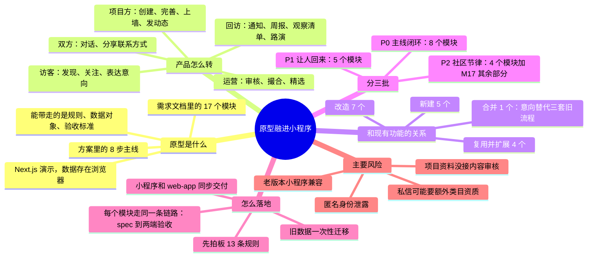

## 2. 原型里的东西去哪

原型的页面代码进不了小程序（小程序要用 WXML 重写）。能直接带走的是文档、规则函数和枚举。

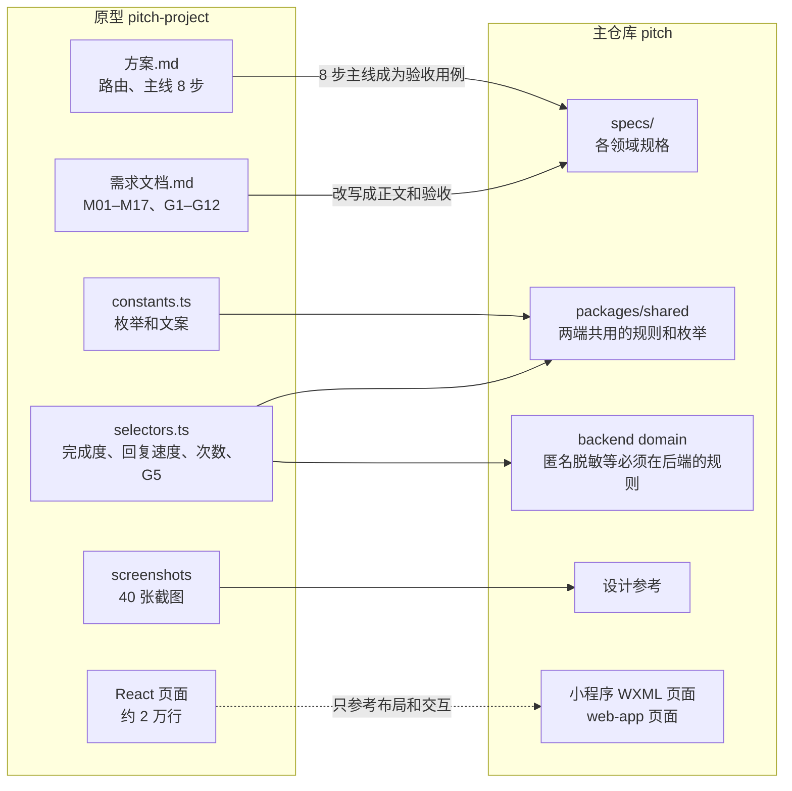

## 3. 产品逻辑

### 3.1 一个循环

原型的核心是一条“被看见、表达意向、对话、撮合”的链路。外面还有两个让它持续转起来的机制：贡献换意向次数；动态和通知把人带回来。

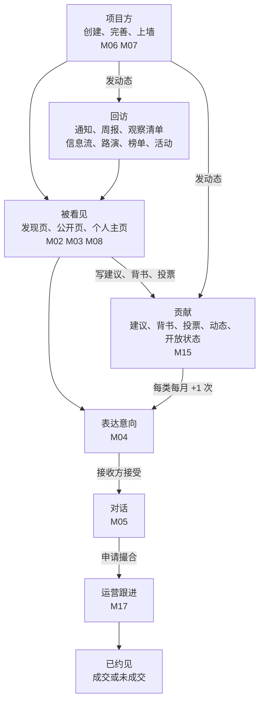

### 3.2 主线 8 步

出自[方案](./方案.md) 4.2。这是 P0 的验收主线，小程序和 web-app 都要走通。

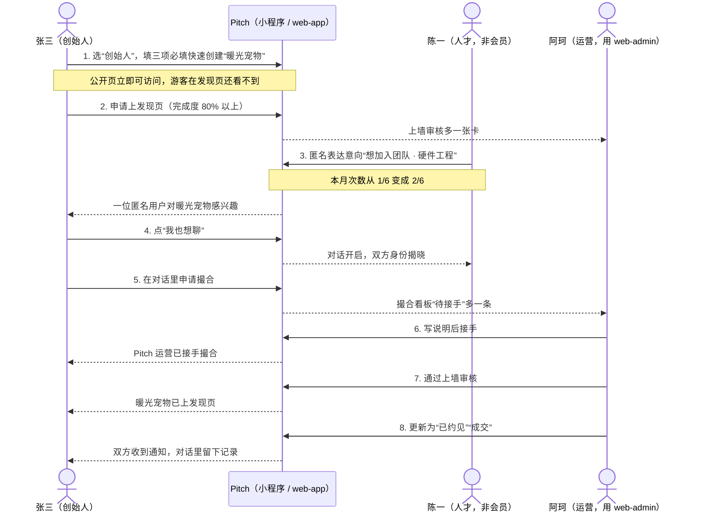

每一步在融合后的系统里落在哪（接口都是 P0 要新增或改造的设计，还没实现）：

| 步骤 | 小程序 / web-app 里在哪 | 接口 |
| --- | --- | --- |
| 1 创建项目 | 资料完善页选身份；创建半屏 | `PUT /community-profiles/me`、`POST /projects/mine` |
| 2 申请上发现页 | 工作台“曝光” | `POST /projects/mine/:projectId/wall-application` |
| 3 匿名发意向 | 项目页底部“表达意向” | `POST /intents` |
| 4 接受意向 | “我的”红点；工作台“意向” | `POST /intents/:intentId/accept` |
| 5 申请撮合 | 对话页 | `POST /conversations/:conversationId/match-request` |
| 6 运营接手 | web-admin 撮合看板 | `POST /matches/:opportunityId/take` |
| 7 上墙审核 | web-admin 项目审核 | `POST /projects/manage/:projectId/wall-review` |
| 8 更新进展 | web-admin 撮合看板 | `POST /matches/:opportunityId/progress` |

## 4. 模块地图

### 4.1 17 个模块分三批

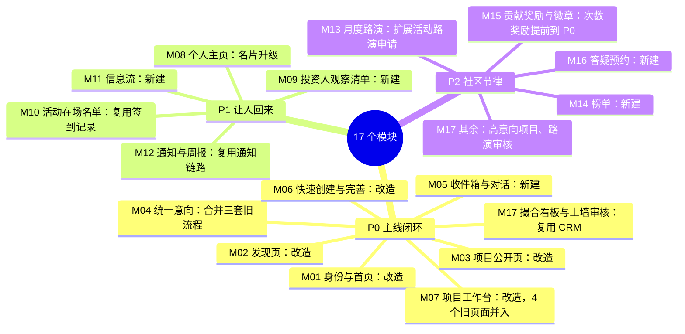

### 4.2 P0 模块之间的依赖

箭头表示前者给后者提供能力；虚线是展示用的汇总数据。

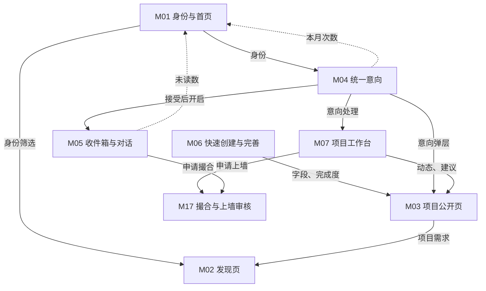

### 4.3 P1、P2 建立在 P0 之上

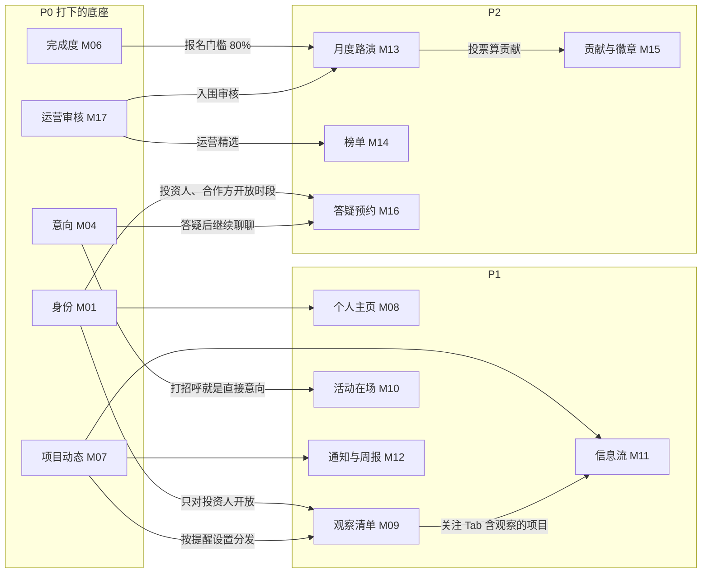

## 5. 贯穿全局的规则

这些规则跨多个模块，写 spec 时要在每个相关领域里保持一致。

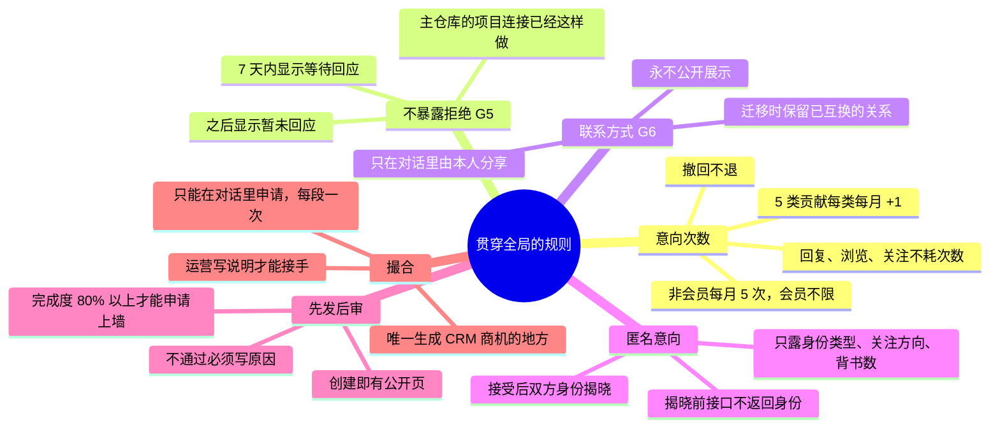

## 6. 核心数据对象

P0 新建的表和它们的关系，分成项目侧和意向对话侧两张图。这是逻辑关系，按主仓库惯例数据库不建外键。

项目侧：挂在项目下的 8 张表，和项目都是一对多。

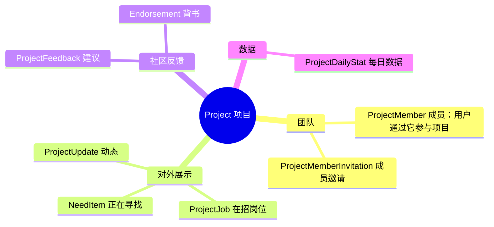

意向对话侧：从发出意向到对话，再到撮合商机。

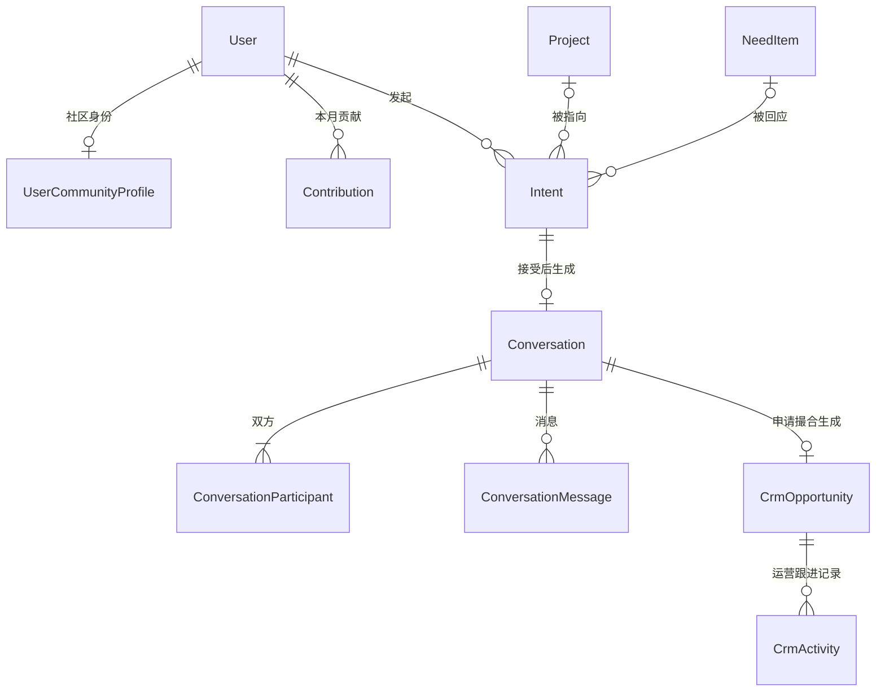

- `NeedItem` 和 `Endorsement` 的对象既可以是项目也可以是人；个人需求在 P1 上线。
- 意向可以只指向一个人（不带项目），也可以回应某条需求或岗位。
- 次数不单独记账：本月已用是本月计次的意向数，奖励是本月完成的贡献种类数（最多 5 种），基数每月 5 次。
- `CrmOpportunity` 和 `CrmActivity` 是主仓库已有的表，只加一个来源类型和来源对话字段。

## 7. 三个状态流转

### 7.1 意向

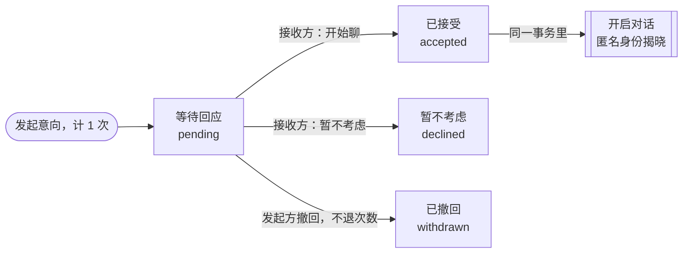

发起方看不到“暂不考虑”：pending 和 declined 在 7 天内都显示“等待回应”，超过 7 天显示“暂未回应”。对同一个项目或同一个人，7 天内只能有一条等待中的意向。

### 7.2 对话与撮合

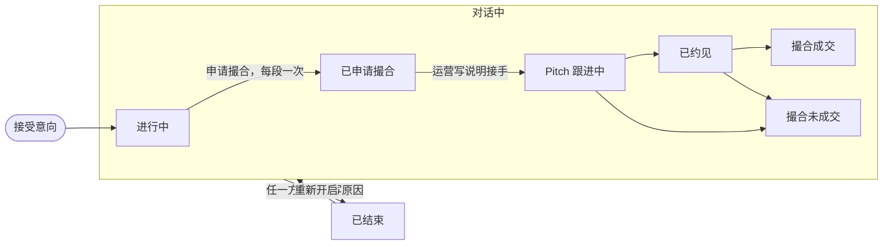

任何状态的对话都能结束。重开时按撮合进度恢复：有运营接手的回到“Pitch 跟进中”，申请过撮合的回到“已申请撮合”，否则回到“进行中”。撮合结案后双方仍可以继续沟通。

撮合阶段直接映射到主仓库 CRM 商机现有的 5 个阶段：

| 对话里显示 | CRM 商机阶段 |
| --- | --- |
| 已申请撮合（待接手） | `open`，负责人为空 |
| Pitch 跟进中 | `communicating` |
| 已约见 | `negotiating` |
| 撮合成交 | `closed_won` |
| 撮合未成交 | `lost`，说明写进 `lostReason` |

### 7.3 项目上墙

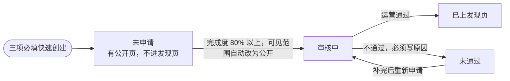

主仓库现在没有“未申请”这一步：一创建就进审核，驳回原因也存不下来。融合后新增 `not_applied`，存量的待审核项目视为已申请。审核中和未通过的项目照样能凭链接访问和分享，这一点主仓库已经支持（项目 spec 的 FR-040、FR-120）。

## 8. 旧功能怎么并进来

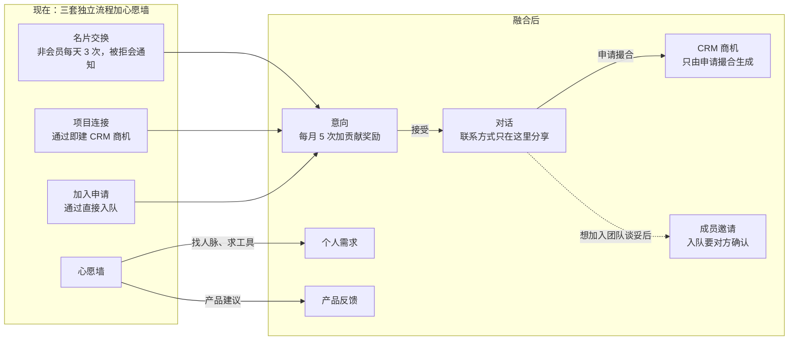

| 旧记录 | 迁成什么 | 已通过的 | 被拒的 | 进行中的 |
| --- | --- | --- | --- | --- |
| 名片交换 | 直接找人的意向 | 建对话，双方标记已互换联系方式 | 记为暂不考虑，不补发通知 | 保持等待回应 |
| 项目连接 | 指向项目的意向：融资为想投资，渠道、流量、品牌为想合作 | 建对话，项目方一侧已分享联系方式；原有商机保留 | 记为暂不考虑 | 保持等待回应 |
| 加入申请 | 想加入团队的意向 | 建对话，成员关系不动 | 记为暂不考虑 | 保持等待回应 |
| 心愿（P1） | 找人脉、求工具迁成个人需求，每人最多 3 条；产品建议迁成产品反馈 | 不适用 | 不适用 | 只迁上架中的 |

迁移按盘点、演练、冻结、执行、校验、兼容六步走。执行会改数据库，每一步执行前都要先确认。

## 9. 新东西放在哪

小程序底栏已满 5 项，不动。新入口集中在“我的”和项目页底部，运营功能只在 web-admin。

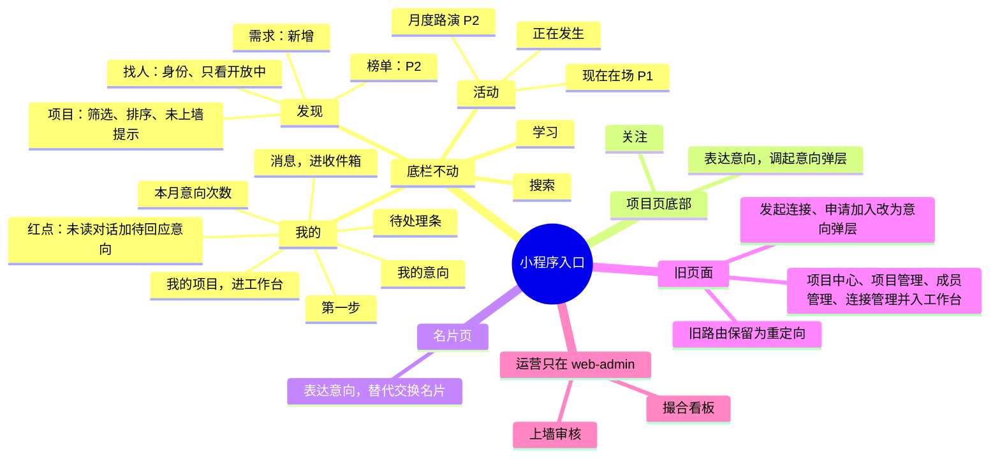

## 10. 交付顺序

### 10.1 每个模块走同一条链路

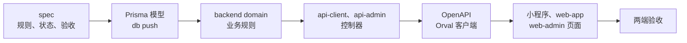

### 10.2 P0 依赖

加粗的是主线。

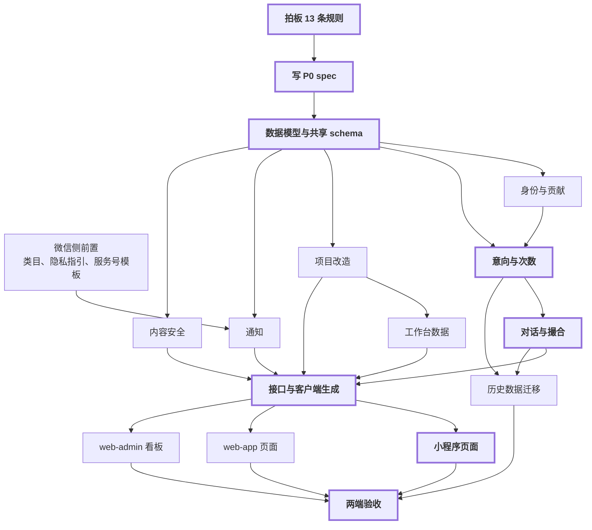

上线时有三个硬性依赖：

- 申请撮合和 web-admin 撮合看板必须一起上线，否则申请没人接。
- 内容安全要先于新的上墙流程上线，因为未上墙的项目也能凭链接公开访问。
- 迁移脚本在切换窗口内执行；旧接口转写成意向或返回升级提示，保留一个版本周期。

## 11. 先拍板的 13 条规则

| # | 规则 | 建议 | 影响模块 |
| --- | --- | --- | --- |
| 1 | 名片交换、项目连接、加入申请是否并入意向 | 全部并入；入队改成意向、对话、成员邀请三步 | M04 M05 M07 M08 |
| 2 | 被拒时是否通知申请人 | 统一不通知，复用主仓库现有的 7 天派生逻辑 | M04 |
| 3 | CRM 商机在哪一步生成 | 只在对话里申请撮合时生成 | M05 M17 |
| 4 | 意向次数按月还是按天 | 按月 5 次，贡献奖励随 P0 上线 | M04 M15 |
| 5 | 联系方式什么时候可见 | 只在对话里由本人分享；迁移时保留已互换的关系 | M03 M05 M08 |
| 6 | 上墙流程 | 新增“未申请”，加完成度门槛，驳回原因必填 | M02 M03 M07 M17 |
| 7 | “仅投资人可见”怎么处理 | 改叫“仅持链接可见”，数据不动 | M03 M06 |
| 8 | 用户身份存在哪 | 新建社区身份表，和账号角色分开 | M01 M02 M08 M09 |
| 9 | 原型首页的内容放哪 | 底栏不动，拆到“我的”“发现”“活动” | M01 M05 |
| 10 | 项目详情页改到什么程度 | 以原型为准，并入 10-21 文档里仍然成立的部分 | M03 M06 |
| 11 | 关注是否复用收藏 | 复用收藏，公开人数、不公开名单 | M02 M03 M08 M11 |
| 12 | 分享来源用什么参数 | 换一个参数名（例如 `src`），加入白名单 | M03 M07 |
| 13 | 怎么切换 | 一次性切换，加强制更新，旧接口过渡一个版本周期 | 全部 P0 模块 |

## 12. 风险

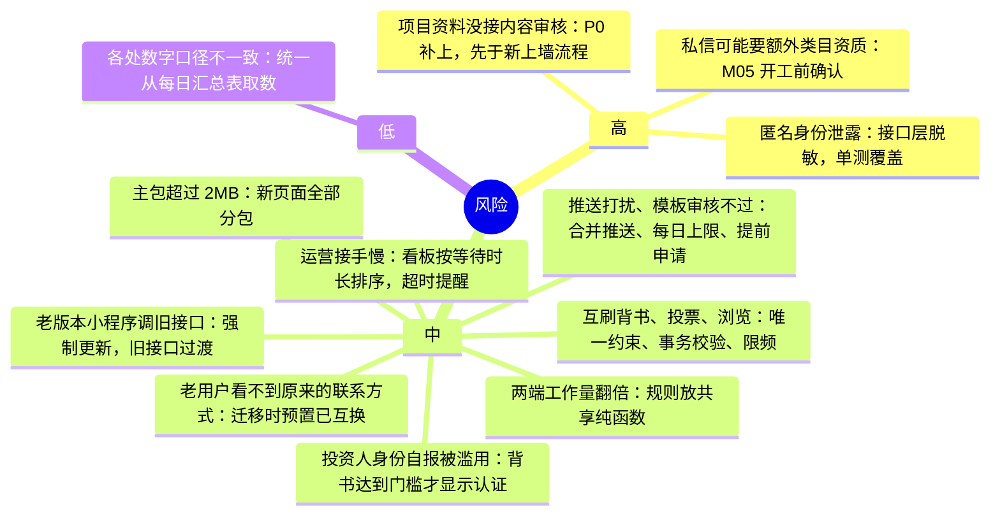
